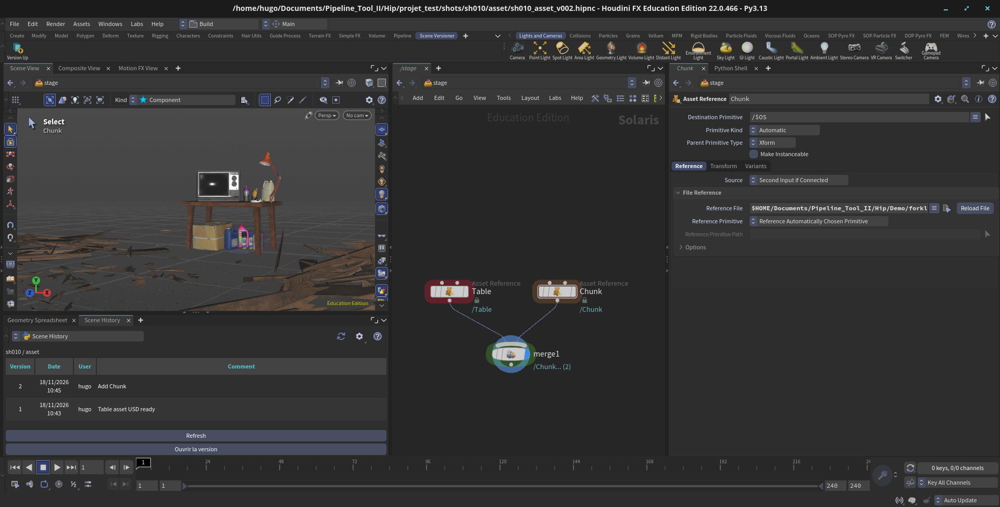

# Houdini Scene Versioner

A small pipeline tool for Houdini 22 that saves scenes as numbered versions following a strict naming convention, records metadata for every version, and lets artists browse and reopen any version from a panel inside Houdini.



## Why not just use *Save with Increment*?

Houdini can already increment a file name (`File > Save with Increment`). That is a good start, but a studio pipeline needs more:

| | Save with Increment | Scene Versioner |
|---|---|---|
| Increments the version number | ✅ | ✅ |
| Never overwrites an existing version (uses the highest version on disk + 1) | — | ✅ |
| Enforced naming convention (`<shot>_<task>_v###`) | — | ✅ |
| Folder structure derived from shot and task | — | ✅ |
| Comment, user, date, Houdini version, frame range for each version | — | ✅ |
| Browsable history with one-click reopen | — | ✅ |

## Features

- **Version up** (shelf tool): saves the current scene as the next free version.
  - Shot and task are pre-filled from the current file name and can be changed, for example to branch an `anim` scene into an `fx` scene.
  - Input is validated (lowercase letters and digits only).
  - The next version is always *highest existing version + 1*, so a version is never overwritten, even when an older version is open.
- **Naming and folder convention**:
  ```
  $JOB/shots/<shot>/<task>/<shot>_<task>_v<###>.<ext>
  ```
  Example: `$JOB/shots/sh010/fx/sh010_fx_v004.hipnc`.
  The extension follows the Houdini license (`.hip`, `.hiplc` or `.hipnc`), and missing folders are created automatically.
- **Metadata**: a JSON file is written next to each version (one file per version, to avoid write conflicts between sessions):
  ```json
  {
      "shot": "sh010",
      "task": "fx",
      "version": 4,
      "comment": "added smoke",
      "user": "hugo",
      "date": "2026-11-11T17:10:14.632583",
      "houdini_version": "22.0.466",
      "frame_range": [1, 240],
      "source": "sh010_fx_v003.hipnc"
  }
  ```
  Versions without a JSON file (created by hand) and empty or corrupt JSON files are handled gracefully.
- **Scene History panel** (Python Panel, PySide6): lists every version of the current shot and task (newest first) with date, user and comment. Double-click or press *Open version* to load a version. If the current scene has unsaved changes, the artist can version up first, open without saving, or cancel.

## Installation

Requirements: Houdini 22 (Python 3, PySide6 6.8 bundled with Houdini).

1. Clone the repository:
   ```bash
   git clone https://github.com/Kaiser-Hugo/houdini-scene-versioner.git
   ```
2. Copy `package/scene_versioner.json` into your Houdini packages folder (for example `~/houdini22.0/packages/`) and edit the path so it points to your clone:
   ```json
   {
       "env": [
           { "SCENE_VERSIONER": "/path/to/houdini-scene-versioner" },
           { "PYTHONPATH": { "value": "$SCENE_VERSIONER/Dev", "method": "prepend" } }
       ],
       "hpath": "$SCENE_VERSIONER"
   }
   ```
3. Define the project root with the `JOB` environment variable, for example with a second package file:
   ```json
   {
       "env": [
           { "JOB": "/path/to/your/project" }
       ]
   }
   ```
4. Restart Houdini. The **Scene Versioner** shelf and the **Scene History** Python Panel interface are now available.

## Usage

- **Version Up**: click the button on the *Scene Versioner* shelf, check the shot and task, add a comment, and press OK.
- **Scene History**: in any pane, open *New Pane Tab Type > Misc > Python Panel* and choose *Scene History* in the interface menu. Use *Refresh* after opening another scene.

## Architecture

The code is split into three layers, so the core logic can be tested without Houdini:

| File | Role | Depends on Houdini |
|---|---|---|
| `Dev/core.py` | Pure logic: parse and build names, find the next version, build folders, read and write metadata, list versions | No |
| `Dev/houdini_tools.py` | Houdini actions: the version up workflow (dialogs, save, metadata) | Yes (`hou`) |
| `Dev/history_ui.py` | PySide6 user interface for the Scene History panel | Yes (`hou`, PySide6) |

The naming rule for shots and tasks is defined once (`NAME_PART_PATTERN`) and reused everywhere, so the convention can change in a single place.

## Tests

The `core` module is covered by `pytest` tests (name parsing, version detection, folder building, metadata read/write, version listing). Tests use temporary folders and never touch real project files.

```bash
pip install pytest
pytest -v
```

## Known limitations and next steps

- Tested on Linux (Pop!_OS) with Houdini 22 Education. Not yet tested on Windows.
- On the COSMIC desktop (Wayland), separate Qt windows opened from Houdini did not receive focus correctly. This is why the history is a Python Panel docked inside Houdini rather than a floating window.
- Ideas for a next version: work/publish distinction, file locking for multi-user work, linking caches to scene versions (with my [cache tool](https://github.com/Kaiser-Hugo/houdini-cache-tool)).
